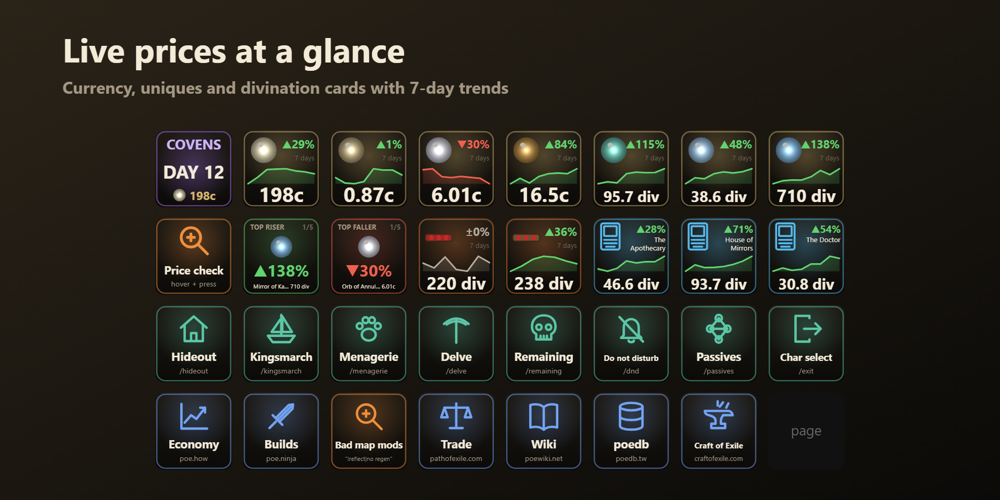

# Exile Deck

Exile Deck is a Stream Deck plugin for Path of Exile. It shows live prices and boss profit on your keys. It can also find
the price of an item in the game when you press one key. The data comes from [poe.how](https://poe.how).

The image shows sample data.

**The plugin is not on Elgato Marketplace yet.**

*This product isn't affiliated with or endorsed by Grinding Gear Games in any way.*

## Requirements

- Windows 10 or later
- Stream Deck 6.6 or later
- Path of Exile 1

## Keys

| Key | Press | Hold |
| --- | --- | --- |
| Price | Show the 7-day chart | Open a trade search |
| Price check | Show the price of the item | Open a trade search for the last item |
| Market movers | Show the next item | Open a trade search |
| Boss profit | Show cost, loot and payback | Open the boss page on poe.how |
| League | Open poe.how | |
| Chat command | Send one command, for example `/hideout` | |
| Regex search | Paste the saved regex into the search box | Copy the regex, or save one on an empty key |
| PoE link | Open a website | |

## Check the price of an item

1. Make sure that the game window is active.
2. Put the mouse pointer on the item.
3. Press the **Price check** key.

The key shows the price for 15 seconds. Price check does not give prices for rare and magic items, except maps.

## Send a chat command

1. Add a **Chat command** key.
2. Enter the command in the key settings.
3. Make sure that the game window is active.
4. Press the key.

## Save a regex on a key

You can save a regex from [poe.re](https://poe.re) or from a different tool. poe.re is an independent project.

1. Copy the regex.
2. Add a **Regex search** key.
3. Hold the empty key to save the regex. As an alternative, paste the regex in the key settings.
4. Open a stash tab, a vendor window or a different window with a search box.
5. Press the key to paste the regex into the search box.

A regex can have a maximum of 250 characters. The key does not press Enter.

## What the plugin does in the game

- The plugin sends input only when you press a key. It has no timers and no automatic triggers.
- One key press does one action in the game. You cannot put Price check, Chat command or Regex search in a Multi Action.
- The plugin sends input only when a Path of Exile window is active.
- Price check sends Ctrl+C one time. Then the plugin reads the item text from the clipboard.
- Regex search sends Ctrl+F, Ctrl+A and Ctrl+V to put one regex into the search box.
- A hold on Regex search changes the clipboard, or saves the clipboard text on an empty key.
- The plugin puts your clipboard text back after each action that sends input. It does not keep images or files that were on the clipboard.
- The plugin does not read the memory or the files of the game.
- You do not need an account or a session cookie.

A PowerShell script sends the input. You can read the script:
[`helper.ps1`](plugin/com.poehow.exile-deck.sdPlugin/bin/helper.ps1).
For network use and local files, refer to [PRIVACY.md](PRIVACY.md).

## Work on the code

The plugin has no runtime dependencies. You need Node 20 or later.

1. Run the tests: `npm test`
2. Validate the plugin: `npm run validate`
3. Make the package: `npm run pack`

For more information, refer to [docs/DEVELOPMENT.md](docs/DEVELOPMENT.md).

## Licence

The licence of the code is [MIT](LICENSE). Path of Exile is a trademark of Grinding Gear Games. The item icons in the
images in `docs/marketplace/` are the property of Grinding Gear Games. The boss images come from poe.how. The MIT licence
does not include these icons and images.

This repository contains only the plugin. The poe.how service is a different project and is not part of this repository.
